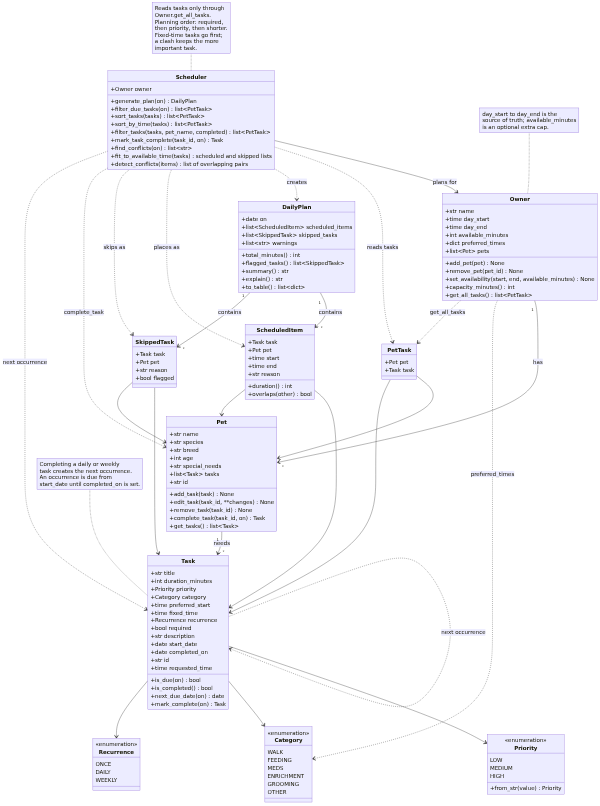
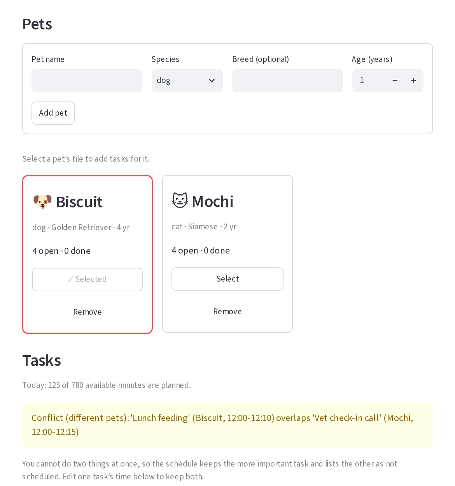
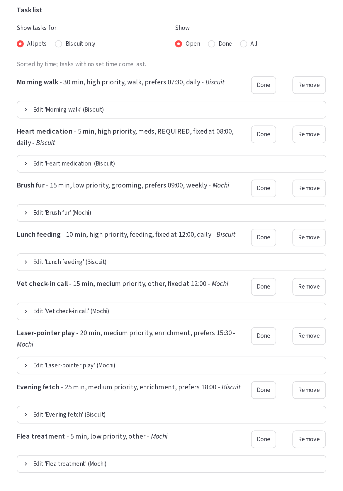
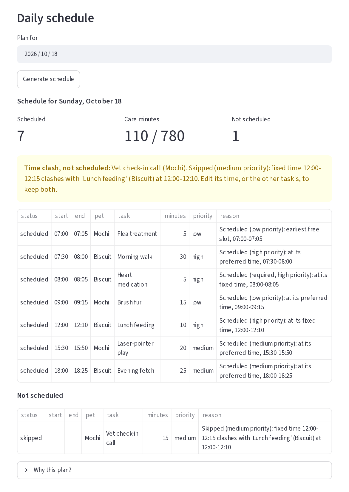

# 🐾 PawPal+

PawPal+ is a Streamlit app that helps a busy pet owner plan a day of care for one or more pets. Tell it about your pets and their tasks (walks, feeding, medication, enrichment, grooming), and it builds a daily schedule that respects your available time, puts the important things first, warns you about clashes, and explains every decision.

## Scenario

A busy pet owner needs help staying consistent with pet care. They want an assistant that can:

- Track pet care tasks (walks, feeding, meds, enrichment, grooming, etc.)
- Consider constraints (time available, priority, owner preferences)
- Produce a daily plan and explain why it chose that plan

## ✨ Features

- **Pets as tiles, tasks per pet.** Add several pets (shown as selectable tiles with open and done counts) and give each tasks with a duration, priority, category, optional notes, whether it is **required** (such as medication), and how often it repeats.
- **A daily plan with reasons.** `Scheduler.generate_plan` turns every pet's tasks into one clock-time schedule and records a reason for each task, scheduled or skipped ("Why this plan?").
- **Sorting by time.** `Scheduler.sort_by_time` lists tasks by the time they ask for, earliest first, with tasks that have no time last; ties go to the higher priority, then the title (ignoring case).
- **Filtering.** `Scheduler.filter_tasks` narrows the list by pet and by completion status (open, done or all).
- **Conflict warnings.** `Scheduler.find_conflicts` warns, as soon as you add a task, when two fixed-time tasks due today overlap, for the same pet or different pets, and says what will happen. When the plan is built, the clash is resolved: the more important task is kept and the other is skipped with a reason.
- **Recurring tasks.** Completing a daily or weekly task creates the next occurrence automatically (`Task.mark_complete`, `Task.next_due_date`), calculated with `timedelta`; a weekly task stays on its weekday even if you finish it late.
- **Flexible, preferred or fixed times.** A task can take the earliest free slot, try a preferred time first, or insist on a fixed time. (In code an owner can also set a default preferred time per category, `Owner.preferred_times`; the app does not expose that yet.)
- **A daily limit.** Set the day's start and end and an optional cap on care minutes; the app warns when today's tasks exceed it, and the plan skips the lowest-priority tasks that do not fit.
- **Required tasks are protected.** A required task that cannot be scheduled is never squeezed in by bumping others; it is flagged in red so you can act.
- **One owner, no double-booking.** Tasks for different pets never overlap, because one person cannot do two things at once.
- **Safe input.** Blank names, non-positive durations, impossible day windows and duplicate pets are rejected with a clear message.
- **Tested.** 177 automated tests cover the backend, the Streamlit app and the class diagram.

## Getting started

```bash
python -m venv .venv
source .venv/bin/activate  # Windows: .venv\Scripts\activate
pip install -r requirements.txt

streamlit run app.py     # the app
python main.py           # the command-line demo
python -m pytest         # the tests
```

New to the app? Open it and press **Load sample data** to get two pets and eight tasks (including a deliberate clash) to explore.

## 🧩 Implementation Summary

**What was built.** The backend is in [pawpal_system.py](pawpal_system.py): a small domain model plus a `Scheduler` that turns it into a one-day plan with a reason for every decision. [main.py](main.py) is a command-line demo, [app.py](app.py) is the Streamlit UI, connected to those classes. The pytest suite (177 tests) is in [tests/test_pawpal.py](tests/test_pawpal.py) for the backend and [tests/test_app.py](tests/test_app.py) for the UI, [tests/test_uml.py](tests/test_uml.py) for the diagram, and the final class diagram is [diagrams/uml_final.mmd](diagrams/uml_final.mmd) (Mermaid source; `tests/test_uml.py` checks it against the code). The picture below is a rendering of it.



**How the classes work together**

- An `Owner` has many `Pet`s, and a `Pet` has many `Task`s. The owner also holds the day window (and an optional daily minutes cap) that a plan must fit inside.
- `Owner.get_all_tasks()` returns every pet's tasks together as `PetTask(pet, task)` pairs. The `Scheduler` reads tasks only through this method, so it always plans across all pets, never one.
- `Scheduler.generate_plan(date)` runs a pipeline: keep the tasks due that day (`Task.is_due`: it has started and is not completed), sort them (required first, then priority, then shorter), fit them onto the clock, and return a `DailyPlan`.
- A `DailyPlan` holds the `ScheduledItem`s (a task at a start and end time, with the reason), the `SkippedTask`s (a task and why it was dropped, `flagged` when a required task could not fit) and a list of warnings. It can print itself as text (`explain()`) or as table rows (`to_table()`).

**Scheduling rules.** There is one owner, so tasks never overlap, even across pets. Fixed-time tasks are placed first; other tasks go at their preferred time if it is free, otherwise in the earliest gap that fits. A task that does not fit is skipped with a reason, and later tasks are still tried. A required task that does not fit is flagged for the owner; it is never forced in by bumping other tasks.

**How the UI connects to the classes** ([app.py](app.py)). `app.py` holds no planning logic; it only collects input, calls the classes above, and displays the result.

- **Memory:** Streamlit re-runs the script on every click, so the `Owner` is kept in `st.session_state`. The app checks `"owner" not in st.session_state` and creates the `Owner` only the first time; after that it reuses the stored object, so pets and tasks persist.
- **Forms call methods:** "Add pet" calls `Owner.add_pet(Pet(...))`; "Add task" calls `Pet.add_task(Task(...))`; "Save changes" calls `Pet.edit_task`; "Save availability" calls `Owner.set_availability`. The classes validate the input, and the UI shows any `ValueError` as an error message.
- **Buttons call methods:** "Done" calls `Scheduler.mark_task_complete` (which creates the next occurrence of a daily or weekly task), and "Remove" calls `Pet.remove_task` or `Owner.remove_pet`, as button callbacks that run before the page redraws.
- **Pets as tiles:** each pet is a bordered tile (icon, name, species, breed and age, open and done task counts, and Select / Remove buttons), laid out three to a row. Selecting a tile chooses which pet new tasks are added to, and a newly added pet is selected automatically. There is no pet dropdown anywhere: the task form follows the selected tile, and the task list has a "Show tasks for" choice between all pets and the selected one.
- **Task list:** it is built with `Scheduler.filter_tasks` (by pet and by Open / Done / All) and ordered with `Scheduler.sort_by_time`. Overlapping fixed-time tasks show a warning from `Scheduler.find_conflicts` as soon as they are added.
- **The daily limit:** "Max care minutes per day" (0 = no limit) caps what the plan schedules each day. Adding tasks is never blocked; instead, the Tasks section warns as soon as today's tasks add up to more than the available time (`Owner.capacity_minutes()`), and the plan then skips the lowest-priority tasks that do not fit, with a reason, and flags any required task it cannot place.
- **Updating the display:** after a successful change the app saves a message and calls `st.rerun()`, so every list shows the new state. "Generate schedule" calls `Scheduler.generate_plan`, and the plan is rebuilt from the live `Owner` on every run, so it never goes stale; it appears as totals, problems (red for a required task left out, amber for a clash, blue for tasks that did not fit), a chronological schedule table, a separate "Not scheduled" table and a "Why this plan?" explanation.

## 📐 Smarter Scheduling

Phase 4 added four features on top of the basic planner. Each is implemented by a named method, and `python main.py` demonstrates all of them.

| Feature | Method(s) | What it does |
|---------|-----------|--------------|
| Sorting by time | `Scheduler.sort_by_time()` (uses `Task.requested_time`) | Orders tasks by the time they ask for, earliest first; tasks with no time go last |
| Filtering | `Scheduler.filter_tasks()` | Keeps tasks for one pet and/or with one completion status |
| Conflict detection | `Scheduler.find_conflicts()`; `Scheduler.detect_conflicts()`; clash handling in `Scheduler.fit_to_available_time()` | Warns about overlapping fixed-time tasks, and resolves clashes when planning |
| Recurring tasks | `Task.mark_complete()`, `Task.next_due_date()`, `Pet.complete_task()`, `Scheduler.mark_task_complete()` | Completing a daily or weekly task creates the next occurrence |

(The planner itself orders tasks by importance, not by time, with `Scheduler.sort_tasks()`: required first, then priority, then shorter.)

**Sorting.** `sort_by_time` uses `sorted()` with a lambda key that returns a tuple: the requested time (`fixed_time`, else `preferred_start`), with `time.max` standing in for "no time" so those tasks sort last without comparing a time to `None`; then higher priority; then title. Times are stored as `datetime.time` values, which compare correctly as they are. Zero-padded `"HH:MM"` strings would also sort correctly, but a string such as `"9:30"` would not, so strings were not used. It returns a new list and leaves its input unchanged.

**Filtering.** `filter_tasks(tasks=None, *, pet_name=None, completed=None)` keeps tasks for a pet (matched ignoring case) and/or by completion status (`True` for finished, `False` for open, `None` for any). Filters combine, an unknown pet gives an empty list, and with no list given it starts from every pet's tasks via `Owner.get_all_tasks()`.

**Conflict detection.** `find_conflicts(on)` returns a list of plain warning messages and never raises or changes anything. It checks every pair of due tasks that have a fixed time, for the same pet or different pets, and uses duration, so two tasks conflict when their time ranges overlap, not only when they start in the same minute (back-to-back tasks do not conflict). When a plan is built, `fit_to_available_time()` resolves the same clashes: it keeps the task that sorts first (required, then priority) and skips the other with a reason and a plan warning. `detect_conflicts()` checks a finished plan, where it should always find none. Both checks share one efficient search, `_overlapping_pairs()`: the spans are sorted by start time once, and each span is compared only with the later ones that start before it ends, stopping at the first that does not. The cost is about the sort plus the number of overlaps found, so a conflict-free day is checked in a single pass (measured at roughly 475 times faster than comparing every pair for 1000 tasks).

**Recurring tasks.** `Task.mark_complete(on)` marks the task done and, for a daily or weekly task, returns a new copy (new id, same details) that is due on `Task.next_due_date(on)`; `Pet.complete_task()` adds it to the pet, and `Scheduler.mark_task_complete(task_id, on)` finds the right pet first. The date is calculated with `timedelta`: a daily task is next due the day after (`on + timedelta(days=1)`), a weekly one a week later. Dates stay on the task's own schedule, so a weekly Monday task finished late on Wednesday is next due the following Monday, not a week from Wednesday. A one-off task, or one already completed, creates nothing, so completing twice never makes a duplicate. Each series has one open occurrence at a time, and finished ones stay in the list as history (filter by status to see them).

**Tradeoffs.** Conflict detection only looks at fixed-time tasks, because flexible tasks have no committed slot and the planner moves them to avoid overlaps. Because the next occurrence is created only when a task is completed, the plan cannot preview future occurrences of a recurring task beyond the next one.

## 🖥️ Sample Output

The daily plan printed by `python main.py` (the full output, including sorting, filtering, conflict warnings and recurring tasks, is in the [Demo Walkthrough](#-demo-walkthrough) below). The dates in the output are the day the script is run, so they change daily.

```
Today's Schedule - Sunday, October 18, 2026
Owner: Jordan | Pets: Biscuit, Mochi
Available: 07:00-20:00
========================================================================
07:00-07:05  Flea treatment (Mochi), 5 min, low priority
             why: Scheduled (low priority): earliest free slot, 07:00-07:05
07:30-08:00  Morning walk (Biscuit), 30 min, high priority
             why: Scheduled (high priority): at its preferred time, 07:30-08:00
08:00-08:05  Heart medication (Biscuit), 5 min, high priority [REQUIRED]
             note: One pill, hidden in a bit of cheese
             why: Scheduled (required, high priority): at its fixed time, 08:00-08:05
09:00-09:15  Brush fur (Mochi), 15 min, low priority
             why: Scheduled (low priority): at its preferred time, 09:00-09:15
12:00-12:10  Lunch feeding (Biscuit), 10 min, high priority
             why: Scheduled (high priority): at its fixed time, 12:00-12:10
15:30-15:50  Laser-pointer play (Mochi), 20 min, medium priority
             why: Scheduled (medium priority): at its preferred time, 15:30-15:50
18:00-18:25  Evening fetch (Biscuit), 25 min, medium priority
             why: Scheduled (medium priority): at its preferred time, 18:00-18:25
------------------------------------------------------------------------
Not scheduled:
  Vet check-in call (Mochi): Skipped (medium priority): fixed time 12:00-12:15 clashes with 'Lunch feeding' (Biscuit) at 12:00-12:10
------------------------------------------------------------------------
WARNING: 'Vet check-in call' for Mochi could not be placed at its fixed time 12:00. Skipped (medium priority): fixed time 12:00-12:15 clashes with 'Lunch feeding' (Biscuit) at 12:00-12:10
========================================================================
7 scheduled (110 min), 1 skipped
```

Notice the clash: *Vet check-in call* and *Lunch feeding* both want 12:00, so the plan keeps one, skips the other, and says why.

## 🧪 Testing PawPal+

Run the whole suite from the project root (with the virtual environment active):

```bash
python -m pytest
```

`pytest.ini` points pytest at `tests/` and the project root, so no other setup is needed. To run one file, name it (for example `python -m pytest tests/test_pawpal.py`); add `-v` to list each test.

**What the tests cover.** There are 177 tests: 130 on the backend (`tests/test_pawpal.py`), 32 that drive the real Streamlit app headlessly (`tests/test_app.py`), and 15 that check the UML diagram against the code (`tests/test_uml.py`). They check five core behaviors, each with happy paths and edge cases:

| Core behavior | Happy path | Edge cases |
|---|---|---|
| **Sorting** (`sort_by_time`, and the order of a plan) | Tasks added out of order come back in chronological order, in the list and in the plan | An empty list; no task has a time; untimed tasks last; midnight counts as a real time; fixed time beats preferred time; ties break by priority then title ignoring case |
| **Recurrence** (daily and weekly) | Completing a daily task creates a new task for the following day, with the same details and a new id | Completed days late or early; across month ends, year ends and a leap day; a weekly task stays on its weekday after late completions; a one-off creates nothing; completing twice never duplicates |
| **Conflict detection** (`find_conflicts`, and the planner) | Overlapping fixed-time tasks are flagged, for the same pet or different pets | Identical duplicate times; a three-way clash reports every pair; overlap by duration, not just start time; back-to-back tasks are not conflicts; the planner then resolves the clash and says why |
| **Planning rules** | No overlaps, everything inside the day window, the daily minutes limit respected, a required task that cannot fit is flagged | A fixed task starting or ending exactly at the window edges, and one minute outside; a task exactly as long as the window; a required task over the limit; fragmented free time; times with seconds; a day with 600 tasks |
| **Pets, retrieval and the UI** | Every pet's tasks are read through `Owner.get_all_tasks`; forms add pets and tasks; pets are tiles and the selected tile receives new tasks | A pet with no tasks next to busy ones; an owner with no pets; an empty list is not treated as "no list"; blank names; duplicate ids; generating a schedule with nothing to schedule; completed tasks drop out of the plan |

On top of the fixed examples, 25 seeded random plans and a 20-case random comparison check invariants (nothing overlaps, nothing is lost, the limit is never exceeded), and the tests were checked the other way round too: across the project, dozens of deliberately injected bugs were each caught by at least one test.

**How to read the trickier tests**
- `@pytest.mark.parametrize` runs one test body once per row of inputs (for example, the calendar-boundary dates), so a failure names the exact row.
- The random tests use a fixed seed (`random.Random(seed)`), so they try many different days but fail the same way every time.
- `test_the_sweep_does_work_proportional_to_the_input_not_to_every_pair` counts how many times the conflict search looks at its list, instead of timing it, so it cannot fail just because the computer is busy.
- The UI tests use Streamlit's `AppTest`, which runs `app.py` without a browser: the test fills a form, clicks a button, and then checks the `Owner` object the app keeps in `st.session_state`.

**Test output** (`python -m pytest`):

```
============================= test session starts ==============================
platform linux -- Python 3.13.15, pytest-9.1.1, pluggy-1.6.0
rootdir: /home/dev/ai110-module2show-pawpal-starter
configfile: pytest.ini
testpaths: tests
plugins: anyio-4.15.1
collected 177 items

tests/test_app.py ................................                       [ 18%]
tests/test_pawpal.py ................................................... [ 46%]
........................................................................ [ 87%]
.......                                                                  [ 91%]
tests/test_uml.py ...............                                        [100%]

============================= 177 passed in 3.74s ==============================
```

**Confidence level: ★★★★☆ (4 out of 5).**

Why it is high: every one of the 177 tests passes; each of the five behaviors is checked on its happy path and its edges; random inputs check the rules that must always hold; and the edge-case round found and fixed a real bug (tasks at the same time and priority were ordered with every capital letter before every lowercase one, so `Cherry` came before `banana`).

Why it is not 5: the tests were written by the same AI assistant that wrote the code, so they can share its blind spots (injecting deliberate bugs reduces this but does not remove it); the UI is tested headlessly and has had only a brief look in a browser; the planner is greedy by design, so tests prove its plans are valid, not that they are the best possible; and overnight days, time zones and seconds in times are not supported (seconds are truncated, and a test documents that). Code coverage has not been measured.

## 📸 Demo Walkthrough

### What you can do in the app

- **Set up the owner:** name, when the day starts and ends, and an optional limit on care minutes per day.
- **Manage pets:** add a pet (name, species, breed, age); each appears as a tile showing its open and done counts. Click a tile's **Select** to choose which pet new tasks go to; **Remove** deletes a pet.
- **Add and edit tasks:** title, notes, duration, priority, category, how often it repeats, a start date, whether it is required, and when it happens (flexible, preferred time, or fixed time). Each task row has **Done**, **Remove** and an **Edit** panel.
- **Browse tasks:** the list is sorted by time; filter it by pet (all pets or the selected one) and by status (open, done, all).
- **Generate a schedule:** pick a date and press **Generate schedule** for totals, warnings, the schedule table, the tasks that were not scheduled, and a "Why this plan?" explanation.
- **Try it instantly:** with no pets yet, **Load sample data** fills the app with the same pets and tasks the command-line demo uses.

### An example workflow

1. **Add a pet.** In *Pets*, type "Biscuit", choose *dog*, add a breed and press **Add pet**. A tile appears, already selected.
2. **Add tasks.** In *Tasks*, add "Morning walk" (30 min, high priority, repeats daily, prefers 07:30), then "Heart medication" (5 min, **required**, fixed at 08:00, repeats daily). Add a second pet, "Mochi", select her tile, and add "Vet check-in call" fixed at 12:00. Add "Lunch feeding" for Biscuit, also fixed at 12:00.
3. **See the warning.** As soon as the second 12:00 task is added, an amber warning names both tasks, both pets and their times, and explains that the schedule can keep only one of them.
4. **Review the list.** The task list shows everything sorted by time. Switch *Show tasks for* to one pet, or *Show* to *Done*, to filter it.
5. **Complete a recurring task.** Press **Done** on "Heart medication". It moves to *Done*, and a new one appears due tomorrow (the page says when).
6. **View today's schedule.** Press **Generate schedule**. The totals show what was scheduled, the clashing task appears in an amber *Time clash, not scheduled* message and in the *Not scheduled* table, and *Why this plan?* gives each decision in words.

### Key Scheduler behaviors shown

- **Sorting by time:** the task list and the schedule are in chronological order, whatever order the tasks were added in; tasks with no time come last.
- **Filtering:** by pet and by completion status, in the task list.
- **Conflict warnings:** before planning, as a warning with a plain-language consequence; while planning, as a skipped task with the reason. A required task that cannot be scheduled is shown in red.
- **Recurring tasks:** completing a daily or weekly task creates the next occurrence.
- **Planning rules:** fixed-time tasks first; preferred time if free, otherwise the earliest gap; required first, then priority, then shorter tasks; the daily limit and the day window are respected.

### Screenshots

Pets as tiles, with the conflict warning that appears when two fixed-time tasks overlap:



The task list, sorted by time (the task with no time is last):



The generated schedule: totals, the clash message, the schedule and the task that was not scheduled:



### Command-line demo

`python main.py` builds the same sample owner and prints every Scheduler feature in the terminal: tasks added out of order, sorted by time, filtered by pet, a conflict warning for the two tasks at 12:00, today's schedule, and recurring tasks being completed (a new one is created for tomorrow, and next week) before filtering by status. The dates in the output are the day the script is run.

```
========================================================================
1. Tasks in the order they were added (out of time order):
  Evening fetch (Biscuit) - prefers 18:00, once, due Oct 18
  Lunch feeding (Biscuit) - fixed at 12:00, daily, due Oct 18
  Heart medication (Biscuit) - fixed at 08:00, daily, due Oct 18
  Morning walk (Biscuit) - prefers 07:30, daily, due Oct 18
  Laser-pointer play (Mochi) - prefers 15:30, once, due Oct 18
  Flea treatment (Mochi) - no set time, once, due Oct 18
  Vet check-in call (Mochi) - fixed at 12:00, once, due Oct 18
  Brush fur (Mochi) - prefers 09:00, weekly, due Oct 18

2. Sorted by time - Scheduler.sort_by_time():
  Morning walk (Biscuit) - prefers 07:30, daily, due Oct 18
  Heart medication (Biscuit) - fixed at 08:00, daily, due Oct 18
  Brush fur (Mochi) - prefers 09:00, weekly, due Oct 18
  Lunch feeding (Biscuit) - fixed at 12:00, daily, due Oct 18
  Vet check-in call (Mochi) - fixed at 12:00, once, due Oct 18
  Laser-pointer play (Mochi) - prefers 15:30, once, due Oct 18
  Evening fetch (Biscuit) - prefers 18:00, once, due Oct 18
  Flea treatment (Mochi) - no set time, once, due Oct 18

3. Filtered by pet - Scheduler.filter_tasks(pet_name='mochi'):
  Laser-pointer play (Mochi) - prefers 15:30, once, due Oct 18
  Flea treatment (Mochi) - no set time, once, due Oct 18
  Vet check-in call (Mochi) - fixed at 12:00, once, due Oct 18
  Brush fur (Mochi) - prefers 09:00, weekly, due Oct 18

4. Conflict warnings - Scheduler.find_conflicts():
  Conflict (different pets): 'Lunch feeding' (Biscuit, 12:00-12:10) overlaps 'Vet check-in call' (Mochi, 12:00-12:15)

========================================================================
Today's Schedule - Sunday, October 18, 2026
Owner: Jordan | Pets: Biscuit, Mochi
Available: 07:00-20:00
========================================================================
07:00-07:05  Flea treatment (Mochi), 5 min, low priority
             why: Scheduled (low priority): earliest free slot, 07:00-07:05
07:30-08:00  Morning walk (Biscuit), 30 min, high priority
             why: Scheduled (high priority): at its preferred time, 07:30-08:00
08:00-08:05  Heart medication (Biscuit), 5 min, high priority [REQUIRED]
             note: One pill, hidden in a bit of cheese
             why: Scheduled (required, high priority): at its fixed time, 08:00-08:05
09:00-09:15  Brush fur (Mochi), 15 min, low priority
             why: Scheduled (low priority): at its preferred time, 09:00-09:15
12:00-12:10  Lunch feeding (Biscuit), 10 min, high priority
             why: Scheduled (high priority): at its fixed time, 12:00-12:10
15:30-15:50  Laser-pointer play (Mochi), 20 min, medium priority
             why: Scheduled (medium priority): at its preferred time, 15:30-15:50
18:00-18:25  Evening fetch (Biscuit), 25 min, medium priority
             why: Scheduled (medium priority): at its preferred time, 18:00-18:25
------------------------------------------------------------------------
Not scheduled:
  Vet check-in call (Mochi): Skipped (medium priority): fixed time 12:00-12:15 clashes with 'Lunch feeding' (Biscuit) at 12:00-12:10
------------------------------------------------------------------------
WARNING: 'Vet check-in call' for Mochi could not be placed at its fixed time 12:00. Skipped (medium priority): fixed time 12:00-12:15 clashes with 'Lunch feeding' (Biscuit) at 12:00-12:10
========================================================================
7 scheduled (110 min), 1 skipped

========================================================================
5. Recurring tasks - Scheduler.mark_task_complete():
  Heart medication (Biscuit) is daily: done today, new one due Monday, October 19.
  Brush fur (Mochi) is weekly: done today, new one due Sunday, October 25.
  Flea treatment (Mochi) is once: done, nothing new created.

6. Filtered by status - completed=True:
  Heart medication (Biscuit) - fixed at 08:00, daily, done Oct 18
  Flea treatment (Mochi) - no set time, once, done Oct 18
  Brush fur (Mochi) - prefers 09:00, weekly, done Oct 18

   Filtered by status - completed=False (open):
  Morning walk (Biscuit) - prefers 07:30, daily, due Oct 18
  Heart medication (Biscuit) - fixed at 08:00, daily, due Oct 19
  Brush fur (Mochi) - prefers 09:00, weekly, due Oct 25
  Lunch feeding (Biscuit) - fixed at 12:00, daily, due Oct 18
  Vet check-in call (Mochi) - fixed at 12:00, once, due Oct 18
  Laser-pointer play (Mochi) - prefers 15:30, once, due Oct 18
  Evening fetch (Biscuit) - prefers 18:00, once, due Oct 18
```

## Project layout

```
app.py                Streamlit UI (no planning logic; it calls the classes below)
main.py               command-line demo; also supplies the sample data for the app
pawpal_system.py      Owner, Pet, Task, PetTask, Scheduler, DailyPlan and the other classes
tests/                test_pawpal.py (backend), test_app.py (the real app, headless), test_uml.py (diagram vs code)
diagrams/             uml_final.mmd (Mermaid source), uml_final.png (rendering), uml.mmd (identical older copy)
screenshots/          the UI screenshots shown above
reflection.md         design choices, tradeoffs and AI collaboration
ai_interactions.md    log of the AI-assisted work
```

## Limitations

- Plans cover a single day and a single owner; overnight days and time zones are not supported, and times are rounded down to the minute.
- The planner is greedy (it places tasks in order of importance), so its plans are valid and explainable but not guaranteed to be the best possible.
- A recurring task creates only its next occurrence when completed, so the plan cannot preview a recurring task beyond that.
- Data lives in the browser session only: closing or refreshing the page starts over. There is no saving to disk.
