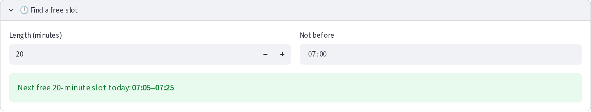

# 🐾 PawPal+

PawPal+ is a Streamlit app that helps a busy pet owner plan a day of care for one or more pets. Tell it about your pets and their tasks (walks, feeding, medication, enrichment, grooming), and it builds a daily schedule that respects your available time, puts the important things first, warns you about clashes, suggests free slots, remembers your data between runs, and explains every decision.

## Scenario

A busy pet owner needs help staying consistent with pet care. They want an assistant that can:

- Track pet care tasks (walks, feeding, meds, enrichment, grooming, etc.)
- Consider constraints (time available, priority, owner preferences)
- Produce a daily plan and explain why it chose that plan

## ✨ Features

- **Pets as tiles, tasks per pet.** Add several pets (shown as selectable tiles with open and done counts) and give each tasks with a duration, priority, category, optional notes, whether it is **required** (such as medication), and how often it repeats.
- **A daily plan with reasons.** `Scheduler.generate_plan` turns every pet's tasks into one clock-time schedule and records a reason for each task, scheduled or skipped ("Why this plan?").
- **Sorting by time.** `Scheduler.sort_by_time` lists tasks by the time they ask for, earliest first, with tasks that have no time last; ties go to the higher priority, then the title (ignoring case).
- **Filtering.** `Scheduler.filter_tasks` narrows the list by pet and by completion status (open, done or all).
- **Conflict warnings.** `Scheduler.find_conflicts` warns, as soon as you add a task, when two fixed-time tasks due today overlap, for the same pet or different pets, and says what will happen. When the plan is built, the clash is resolved: the more important task is kept and the other is skipped with a reason.
- **Next free slot.** `Scheduler.next_available_slot` finds the earliest free gap of a given length in the day's plan, optionally not before a given time. The app offers it in a "Find a free slot" panel and uses it to suggest where a task that lost a clash could go.
- **Recurring tasks.** Completing a daily or weekly task creates the next occurrence automatically (`Task.mark_complete`, `Task.next_due_date`), calculated with `timedelta`; a weekly task stays on its weekday even if you finish it late.
- **Flexible, preferred or fixed times.** A task can take the earliest free slot, try a preferred time first, or insist on a fixed time. (In code an owner can also set a default preferred time per category, `Owner.preferred_times`; the app does not expose that yet.)
- **A daily limit.** Set the day's start and end and an optional cap on care minutes; the app warns when today's tasks exceed it, and the plan skips the lowest-priority tasks that do not fit.
- **Required tasks are protected.** A required task that cannot be scheduled is never squeezed in by bumping others; it is flagged in red so you can act.
- **One owner, no double-booking.** Tasks for different pets never overlap, because one person cannot do two things at once.
- **Remembers your data.** Pets and tasks are saved to `data.json` automatically (`Owner.save_to_json`) and loaded the next time (`Owner.load_from_json`). A damaged file is set aside, never overwritten. See [Data persistence](#-data-persistence).
- **Easy to read.** An emoji for each kind of pet and task (🐶 🐱, 💊 🐕 🍖 🎾 🛁), color-coded priority (🔴 🟡 🟢) and status (✅ scheduled, ⛔ not scheduled, 🚨 required task left out), a red REQUIRED tag, green / blue / red task status (done / starts later / overdue), and aligned tables in both the app and the terminal.
- **Safe input.** Blank names, non-positive durations, impossible day windows and duplicate pets are rejected with a clear message.
- **Tested.** 314 automated tests cover the backend, the app, the formatting, the demo and the class diagram.

## 🏆 Extra-credit challenges

| Challenge | What was built | Where |
|---|---|---|
| **1. Advanced algorithm** | `Scheduler.next_available_slot`: the earliest free gap that fits, respecting the day window, the daily limit and a "not before" time | [Smarter Scheduling](#-smarter-scheduling); the "Find a free slot" panel and clash suggestions in `app.py`; `main.py` step 5 |
| **2. Data persistence** | `Owner.save_to_json` / `Owner.load_from_json` (with `to_dict` / `from_dict` on `Task`, `Pet` and `Owner`), autosave and safe loading in the app | [Data persistence](#-data-persistence) |
| **3. Professional output** | `display.py`: emoji for task types and pets, color-coded priority and status, `tabulate` tables in the terminal, aligned and tested | [Features](#-features); the screenshots below; `main.py` output |

The agent workflow for these (files changed, what was asked, what was done, corrections) is in the "Agent Workflow" section of [ai_interactions.md](ai_interactions.md).

## Getting started

```bash
python -m venv .venv
source .venv/bin/activate  # Windows: .venv\Scripts\activate
pip install -r requirements.txt

streamlit run app.py     # the app (your pets and tasks are saved to data.json)
python main.py           # the command-line demo (saves nothing to your data.json)
python -m pytest         # the tests (they use temporary files, never your data.json)
```

New to the app? Open it and press **Load sample data** to get two pets and eight tasks (including a deliberate clash) to explore.

## 🧩 Implementation Summary

**What was built.** The backend is in [pawpal_system.py](pawpal_system.py): a small domain model plus a `Scheduler` that turns it into a one-day plan with a reason for every decision. [main.py](main.py) is a command-line demo, [app.py](app.py) is the Streamlit UI, connected to those classes. The pytest suite (314 tests) is in [tests/](tests/): the backend ([test_pawpal.py](tests/test_pawpal.py)), the real app run headlessly ([test_app.py](tests/test_app.py)), the display formatting ([test_display.py](tests/test_display.py)), the command-line demo ([test_main.py](tests/test_main.py)) and the diagram ([test_uml.py](tests/test_uml.py)). [display.py](display.py) turns results into emoji, color-coded badges and tables for both the app and the terminal. The final class diagram is [diagrams/uml_final.mmd](diagrams/uml_final.mmd) (Mermaid source; `tests/test_uml.py` checks it against the code). The picture below is a rendering of it.


**How the classes work together**

- An `Owner` has many `Pet`s, and a `Pet` has many `Task`s. The owner also holds the day window (and an optional daily minutes cap) that a plan must fit inside.
- `Owner.get_all_tasks()` returns every pet's tasks together as `PetTask(pet, task)` pairs. The `Scheduler` reads tasks only through this method, so it always plans across all pets, never one.
- `Scheduler.generate_plan(date)` runs a pipeline: keep the tasks due that day (`Task.is_due`: it has started and is not completed), sort them (required first, then priority, then shorter), fit them onto the clock, and return a `DailyPlan`.
- A `DailyPlan` holds the `ScheduledItem`s (a task at a start and end time, with the reason), the `SkippedTask`s (a task and why it was dropped, `flagged` when a required task could not fit) and a list of warnings. It can print itself as text (`explain()`) or as table rows (`to_table()`).

**Scheduling rules.** There is one owner, so tasks never overlap, even across pets. Fixed-time tasks are placed first; other tasks go at their preferred time if it is free, otherwise in the earliest gap that fits. A task that does not fit is skipped with a reason, and later tasks are still tried. A required task that does not fit is flagged for the owner; it is never forced in by bumping other tasks.

**How the UI connects to the classes** ([app.py](app.py)). `app.py` holds no planning logic; it only collects input, calls the classes above, and displays the result.

- **Memory:** Streamlit re-runs the script on every click, so the `Owner` is kept in `st.session_state`. The app checks `"owner" not in st.session_state` and creates the `Owner` only the first time (loading it from `data.json` if that file exists); after that it reuses the stored object. Every run ends by saving to `data.json` if anything changed (see [Data persistence](#-data-persistence)).
- **Forms call methods:** "Add pet" calls `Owner.add_pet(Pet(...))`; "Add task" calls `Pet.add_task(Task(...))`; "Save changes" calls `Pet.edit_task`; "Save availability" calls `Owner.set_availability`. The classes validate the input, and the UI shows any `ValueError` as an error message.
- **Buttons call methods:** "Done" calls `Scheduler.mark_task_complete` (which creates the next occurrence of a daily or weekly task), and "Remove" calls `Pet.remove_task` or `Owner.remove_pet`, as button callbacks that run before the page redraws.
- **Pets as tiles:** each pet is a bordered tile (icon, name, species, breed and age, open and done task counts, and Select / Remove buttons), laid out three to a row. Selecting a tile chooses which pet new tasks are added to, and a newly added pet is selected automatically. There is no pet dropdown anywhere: the task form follows the selected tile, and the task list has a "Show tasks for" choice between all pets and the selected one.
- **Task list:** it is built with `Scheduler.filter_tasks` (by pet and by Open / Done / All) and ordered with `Scheduler.sort_by_time`. Overlapping fixed-time tasks show a warning from `Scheduler.find_conflicts` as soon as they are added.
- **The daily limit:** "Max care minutes per day" (0 = no limit) caps what the plan schedules each day. Adding tasks is never blocked; instead, the Tasks section warns as soon as today's tasks add up to more than the available time (`Owner.capacity_minutes()`), and the plan then skips the lowest-priority tasks that do not fit, with a reason, and flags any required task it cannot place.
- **Free slots:** a "Find a free slot" panel calls `Scheduler.next_available_slot`, and a clash message in the schedule suggests where the task that lost out could go instead.
- **Formatting:** `display.py` supplies the emoji, color-coded priority and status badges and the table rows the app shows (the same module formats the terminal tables in `main.py`).
- **Updating the display:** after a successful change the app saves a message and calls `st.rerun()`, so every list shows the new state. "Generate schedule" calls `Scheduler.generate_plan`, and the plan is rebuilt from the live `Owner` on every run, so it never goes stale; it appears as totals, problems (red for a required task left out, amber for a clash, blue for tasks that did not fit), a chronological schedule table, a separate "Not scheduled" table and a "Why this plan?" explanation.

## 📐 Smarter Scheduling

Phase 4 added four features on top of the basic planner, and a fifth (the next free slot) was added as an extra-credit challenge. Each is implemented by a named method, and `python main.py` demonstrates all of them.

| Feature | Method(s) | What it does |
|---------|-----------|--------------|
| Sorting by time | `Scheduler.sort_by_time()` (uses `Task.requested_time`) | Orders tasks by the time they ask for, earliest first; tasks with no time go last |
| Filtering | `Scheduler.filter_tasks()` | Keeps tasks for one pet and/or with one completion status |
| Conflict detection | `Scheduler.find_conflicts()`; `Scheduler.detect_conflicts()`; clash handling in `Scheduler.fit_to_available_time()` | Warns about overlapping fixed-time tasks, and resolves clashes when planning |
| Recurring tasks | `Task.mark_complete()`, `Task.next_due_date()`, `Pet.complete_task()`, `Scheduler.mark_task_complete()` | Completing a daily or weekly task creates the next occurrence |
| Next free slot (extra credit) | `Scheduler.next_available_slot()` | Finds the earliest free gap of a given length in the day's plan |

(The planner itself orders tasks by importance, not by time, with `Scheduler.sort_tasks()`: required first, then priority, then shorter.)

**Sorting.** `sort_by_time` uses `sorted()` with a lambda key that returns a tuple: the requested time (`fixed_time`, else `preferred_start`), with `time.max` standing in for "no time" so those tasks sort last without comparing a time to `None`; then higher priority; then title. Times are stored as `datetime.time` values, which compare correctly as they are. Zero-padded `"HH:MM"` strings would also sort correctly, but a string such as `"9:30"` would not, so strings were not used. It returns a new list and leaves its input unchanged.

**Filtering.** `filter_tasks(tasks=None, *, pet_name=None, completed=None)` keeps tasks for a pet (matched ignoring case) and/or by completion status (`True` for finished, `False` for open, `None` for any). Filters combine, an unknown pet gives an empty list, and with no list given it starts from every pet's tasks via `Owner.get_all_tasks()`.

**Conflict detection.** `find_conflicts(on)` returns a list of plain warning messages and never raises or changes anything. It checks every pair of due tasks that have a fixed time, for the same pet or different pets, and uses duration, so two tasks conflict when their time ranges overlap, not only when they start in the same minute (back-to-back tasks do not conflict). When a plan is built, `fit_to_available_time()` resolves the same clashes: it keeps the task that sorts first (required, then priority) and skips the other with a reason and a plan warning. `detect_conflicts()` checks a finished plan, where it should always find none. Both checks share one efficient search, `_overlapping_pairs()`: the spans are sorted by start time once, and each span is compared only with the later ones that start before it ends, stopping at the first that does not. The cost is about the sort plus the number of overlaps found, so a conflict-free day is checked in a single pass (measured at roughly 475 times faster than comparing every pair for 1000 tasks).

**Recurring tasks.** `Task.mark_complete(on)` marks the task done and, for a daily or weekly task, returns a new copy (new id, same details) that is due on `Task.next_due_date(on)`; `Pet.complete_task()` adds it to the pet, and `Scheduler.mark_task_complete(task_id, on)` finds the right pet first. The date is calculated with `timedelta`: a daily task is next due the day after (`on + timedelta(days=1)`), a weekly one a week later. Dates stay on the task's own schedule, so a weekly Monday task finished late on Wednesday is next due the following Monday, not a week from Wednesday. A one-off task, or one already completed, creates nothing, so completing twice never makes a duplicate. Each series has one open occurrence at a time, and finished ones stay in the list as history (filter by status to see them).

**Tradeoffs.** Conflict detection only looks at fixed-time tasks, because flexible tasks have no committed slot and the planner moves them to avoid overlaps. Because the next occurrence is created only when a task is completed, the plan cannot preview future occurrences of a recurring task beyond the next one.

**Next free slot (extra credit).** `next_available_slot(on, minutes, not_before=None)` answers "when could a new task of this length go?". It builds the plan for that day, subtracts every scheduled task from the day window to get the free gaps, and returns the first gap, in time order, that is long enough, as `(start, end)`, or `None` if there is none. So the answer is the *earliest* slot, and a new task placed there cannot clash with or move anything already planned. `not_before` skips earlier gaps (a slot may start part-way into a gap), which is how a task that wanted 12:00 gets "the next free slot after 12:00". The daily limit counts: if `minutes` more would go over `available_minutes`, there is no slot, even if the day has room. A slot may end exactly when the day ends. The app uses it in the "Find a free slot" panel and in clash messages ("The next free 15-minute slot after 12:00 is 12:10–12:25"), and `main.py` step 5 shows it. Its tests compare it with a brute-force minute-by-minute scan on 40 random days, and check that a task fixed at the returned slot is scheduled exactly there with nothing else moving.

## 💾 Data Persistence

PawPal+ remembers your pets and tasks between runs by saving them to a `data.json` file.

### How it works

1. **First run.** If there is no `data.json`, the app starts empty. Nothing is written until you change something.
2. **Every change is saved.** At the end of every run of the app, it compares the owner's data with what it last saved and, if anything changed, calls `Owner.save_to_json("data.json")`. That covers every kind of change: adding, editing, completing and removing pets and tasks, changing the day's hours, loading the sample data, and clearing everything.
3. **Next run.** When a new browser session starts, the app calls `Owner.load_from_json("data.json")` and shows "Loaded 2 pet(s) and 8 task(s) from data.json". Opening the app does not rewrite the file.
4. **A damaged file is never destroyed.** If `data.json` cannot be read (invalid JSON, the wrong version, a missing field, or a value the classes reject), the app moves it to `data.json.damaged`, shows an error that says why, and starts empty, so the next save cannot overwrite your only copy. If the location cannot be written (for example a read-only disk), the app shows a warning and keeps working in memory.
5. **Starting over.** The "Saved data" panel at the bottom has a **Clear all data** button, enabled only after you tick a confirmation box; it empties the app and the file.

### How complex objects become JSON

I used a hand-written dictionary conversion instead of a library such as marshmallow. A pet owns tasks and the owner owns pets, but the structure is small and the classes already validate themselves, so the simplest correct design was:

- `to_dict()` on `Task`, `Pet` and `Owner` produces plain JSON-safe data: enums by name (`"HIGH"`, `"WALK"`, `"DAILY"`), times and dates as ISO text (`"08:00:00"`, `"2026-10-18"`), ids kept, and tasks nested inside their pet.
- `from_dict()` rebuilds objects **through their constructors**, so every rule runs again on load (a task needs a title and a positive duration, a pet needs a name, the day must end after it starts, ids must be unique). A hand-edited file that breaks a rule is rejected with a `ValueError` naming the pet and task, never half-loaded. Optional fields have defaults, so a minimal hand-written file loads.
- `save_to_json(path)` writes a temporary file and then moves it over `data.json`, so a crash or a full disk during the write cannot leave a half-written file. `load_from_json(path)` raises `FileNotFoundError` for a missing file and `ValueError` for anything wrong inside it.
- The file has a `"version": 1` field so a future change to the layout can be told apart from a damaged file.

```json
{
  "version": 1,
  "owner": {
    "name": "Jordan",
    "day_start": "07:00:00",
    "day_end": "20:00:00",
    "available_minutes": null,
    "preferred_times": {},
    "pets": [{"id": "…", "name": "Biscuit", "species": "dog", "tasks": [{"title": "Morning walk", "priority": "HIGH", "…": "…"}]}]
  }
}
```

### Where the file lives, and which files changed

`data.json` is created next to `app.py`. To use another location, set the `PAWPAL_DATA_FILE` environment variable (the tests do this so they never touch your data). `data.json` is listed in `.gitignore` because it is your own data, not part of the project.

| File | Change |
|---|---|
| [pawpal_system.py](pawpal_system.py) | `to_dict` / `from_dict` on `Task`, `Pet` and `Owner`; `Owner.save_to_json` and `Owner.load_from_json`; `DATA_VERSION` and small helpers |
| [app.py](app.py) | `data_file`, `load_saved_owner`, `get_owner` (loads on first use), `autosave` (end of every run), `clear_all`, and the "Saved data" panel |
| [main.py](main.py) | Step 8 saves to a temporary folder and loads it back, printing that the result is identical |
| [tests/test_pawpal.py](tests/test_pawpal.py), [tests/test_app.py](tests/test_app.py) | Round trips, every kind of damaged file, safe writes; autosave, a new session loading, damaged-file handling, clear-all; the UI tests now use a temporary data file |
| [tests/test_uml.py](tests/test_uml.py), [diagrams/uml_final.mmd](diagrams/uml_final.mmd) | The diagram shows the new methods, and the test checks it |
| [.gitignore](.gitignore) | Ignores `data.json`, `data.json.tmp` and `data.json.damaged` |

## 🖥️ Sample Output

The daily plan printed by `python main.py` (the full output, including sorting, filtering, conflict warnings, free slots, recurring tasks and saving, is in the [Demo Walkthrough](#-demo-walkthrough) below). The dates in the output are the day the script is run, so they change daily.

```
🐾 Today's Schedule - Sunday, October 18, 2026
Owner: Jordan | Pets: 🐶 Biscuit, 🐱 Mochi
Available: 07:00-20:00
========================================================================
╭──────────────┬─────────────┬────────────┬───────────────────────┬───────┬────────────┬─────────────────────────────────────────────╮
│ Status       │ Time        │ Pet        │ Task                  │   Min │ Priority   │ Why                                         │
├──────────────┼─────────────┼────────────┼───────────────────────┼───────┼────────────┼─────────────────────────────────────────────┤
│ ✅ Scheduled │ 07:00–07:05 │ 🐱 Mochi   │ 📌 Flea treatment     │     5 │ 🟢 Low     │ Scheduled (low priority): earliest free     │
│              │             │            │                       │       │            │ slot, 07:00-07:05                           │
│ ✅ Scheduled │ 07:30–08:00 │ 🐶 Biscuit │ 🐕 Morning walk       │    30 │ 🔴 High    │ Scheduled (high priority): at its preferred │
│              │             │            │                       │       │            │ time, 07:30-08:00                           │
│ ✅ Scheduled │ 08:00–08:05 │ 🐶 Biscuit │ 💊 Heart medication   │     5 │ 🔴 High    │ Scheduled (required, high priority): at its │
│              │             │            │                       │       │            │ fixed time, 08:00-08:05                     │
│ ✅ Scheduled │ 09:00–09:15 │ 🐱 Mochi   │ 🛁 Brush fur          │    15 │ 🟢 Low     │ Scheduled (low priority): at its preferred  │
│              │             │            │                       │       │            │ time, 09:00-09:15                           │
│ ✅ Scheduled │ 12:00–12:10 │ 🐶 Biscuit │ 🍖 Lunch feeding      │    10 │ 🔴 High    │ Scheduled (high priority): at its fixed     │
│              │             │            │                       │       │            │ time, 12:00-12:10                           │
│ ✅ Scheduled │ 15:30–15:50 │ 🐱 Mochi   │ 🎾 Laser-pointer play │    20 │ 🟡 Medium  │ Scheduled (medium priority): at its         │
│              │             │            │                       │       │            │ preferred time, 15:30-15:50                 │
│ ✅ Scheduled │ 18:00–18:25 │ 🐶 Biscuit │ 🎾 Evening fetch      │    25 │ 🟡 Medium  │ Scheduled (medium priority): at its         │
│              │             │            │                       │       │            │ preferred time, 18:00-18:25                 │
╰──────────────┴─────────────┴────────────┴───────────────────────┴───────┴────────────┴─────────────────────────────────────────────╯

Not scheduled:
╭──────────────────┬──────────┬──────────────────────┬───────┬────────────┬──────────────────────────────────────────╮
│ Status           │ Pet      │ Task                 │   Min │ Priority   │ Why                                      │
├──────────────────┼──────────┼──────────────────────┼───────┼────────────┼──────────────────────────────────────────┤
│ ⛔ Not scheduled │ 🐱 Mochi │ 📌 Vet check-in call │    15 │ 🟡 Medium  │ Skipped (medium priority): fixed time    │
│                  │          │                      │       │            │ 12:00-12:15 clashes with 'Lunch feeding' │
│                  │          │                      │       │            │ (Biscuit) at 12:00-12:10                 │
╰──────────────────┴──────────┴──────────────────────┴───────┴────────────┴──────────────────────────────────────────╯
🚧 Vet check-in call (Mochi): Skipped (medium priority): fixed time 12:00-12:15 clashes with 'Lunch feeding' (Biscuit) at 12:00-12:10
========================================================================
7 scheduled (110 min), 1 skipped
```

Notice the clash: *Vet check-in call* and *Lunch feeding* both want 12:00, so the plan keeps one, skips the other, and says why.

## 🧪 Testing PawPal+

Run the whole suite from the project root (with the virtual environment active):

```bash
python -m pytest
```

`pytest.ini` points pytest at `tests/` and the project root, so no other setup is needed. To run one file, name it (for example `python -m pytest tests/test_pawpal.py`); add `-v` to list each test.

**What the tests cover.** There are 314 tests: 208 on the backend (`tests/test_pawpal.py`), 50 that drive the real Streamlit app headlessly (`tests/test_app.py`), 37 on the emoji, badges and tables (`tests/test_display.py`), 15 that check the UML diagram against the code (`tests/test_uml.py`) and 4 that run the command-line demo (`tests/test_main.py`). They check these core behaviors, each with happy paths and edge cases:

| Core behavior | Happy path | Edge cases |
|---|---|---|
| **Sorting** (`sort_by_time`, and the order of a plan) | Tasks added out of order come back in chronological order, in the list and in the plan | An empty list; no task has a time; untimed tasks last; midnight counts as a real time; fixed time beats preferred time; ties break by priority then title ignoring case |
| **Recurrence** (daily and weekly) | Completing a daily task creates a new task for the following day, with the same details and a new id | Completed days late or early; across month ends, year ends and a leap day; a weekly task stays on its weekday after late completions; a one-off creates nothing; completing twice never duplicates |
| **Conflict detection** (`find_conflicts`, and the planner) | Overlapping fixed-time tasks are flagged, for the same pet or different pets | Identical duplicate times; a three-way clash reports every pair; overlap by duration, not just start time; back-to-back tasks are not conflicts; the planner then resolves the clash and says why |
| **Planning rules** | No overlaps, everything inside the day window, the daily minutes limit respected, a required task that cannot fit is flagged | A fixed task starting or ending exactly at the window edges, and one minute outside; a task exactly as long as the window; a required task over the limit; fragmented free time; times with seconds; a day with 600 tasks |
| **Pets, retrieval and the UI** | Every pet's tasks are read through `Owner.get_all_tasks`; forms add pets and tasks; pets are tiles and the selected tile receives new tasks | A pet with no tasks next to busy ones; an owner with no pets; an empty list is not treated as "no list"; blank names; duplicate ids; generating a schedule with nothing to schedule; completed tasks drop out of the plan |
| **Next free slot** | The earliest gap that fits is found; a task fixed there is scheduled exactly there | Gaps of exactly the right length; `not_before` part-way into a gap, before the day, after the day; ending exactly at closing time; the daily limit; completed and not-yet-due tasks ignored; compared with a brute-force scan on 40 random days |
| **Saving and loading** | An owner with pets, tasks, completed and recurring tasks, times with seconds, optional fields and non-ASCII text comes back exactly equal; a loaded owner plans exactly like the original | A missing file; invalid JSON; the wrong version; a missing field; a value the classes reject (zero minutes, a blank name, a bad time, an unknown priority); duplicate ids; a failed write leaves the old file intact and no temporary file; and in the app: autosave after every kind of change, a new session loads the data, a damaged file is set aside and never overwritten, an unwritable location only warns |
| **Display** | Emoji and colour-coded badges for task types, priorities and statuses; tables for the app and the terminal | Every symbol is one code point and two cells wide; a table's lines are all the same width even with emoji; a long reason wraps; an empty table says "(none)"; the demo output is identical from run to run |

On top of the fixed examples, 25 seeded random plans and a 20-case random comparison check invariants (nothing overlaps, nothing is lost, the limit is never exceeded), and the tests were checked the other way round too: across the project, dozens of deliberately injected bugs were each caught by at least one test.

**How to read the trickier tests**
- `@pytest.mark.parametrize` runs one test body once per row of inputs (for example, the calendar-boundary dates), so a failure names the exact row.
- The random tests use a fixed seed (`random.Random(seed)`), so they try many different days but fail the same way every time.
- `test_the_sweep_does_work_proportional_to_the_input_not_to_every_pair` counts how many times the conflict search looks at its list, instead of timing it, so it cannot fail just because the computer is busy.
- The UI tests use Streamlit's `AppTest`, which runs `app.py` without a browser: the test fills a form, clicks a button, and then checks the `Owner` object the app keeps in `st.session_state`.

**Test output** (`python -m pytest`):

```
============================= test session starts ==============================
platform linux -- Python 3.13.15, pytest-9.1.1, pluggy-1.6.0
rootdir: /home/dev/ai110-module2show-pawpal-starter
configfile: pytest.ini
testpaths: tests
plugins: anyio-4.15.1
collected 314 items

tests/test_app.py ..................................................     [ 15%]
tests/test_display.py .....................................              [ 27%]
tests/test_main.py ....                                                  [ 28%]
tests/test_pawpal.py ................................................... [ 45%]
........................................................................ [ 68%]
........................................................................ [ 91%]
.............                                                            [ 95%]
tests/test_uml.py ...............                                        [100%]

============================= 314 passed in 6.51s ==============================
```

**Confidence level: ★★★★☆ (4 out of 5).**

Why it is high: every one of the 314 tests passes; each core behavior is checked on its happy path and its edges (including saving and loading, where every kind of damaged file is rejected without losing the good one); random inputs check the rules that must always hold; and the edge-case round found and fixed a real bug (tasks at the same time and priority were ordered with every capital letter before every lowercase one, so `Cherry` came before `banana`).

Why it is not 5: the tests were written by the same AI assistant that wrote the code, so they can share its blind spots (injecting deliberate bugs reduces this but does not remove it); the UI is tested headlessly and in screenshots, and has had only a brief hand check in a browser; the data file is single-user and local; the planner is greedy by design, so tests prove its plans are valid, not that they are the best possible; and overnight days, time zones and seconds in times are not supported (seconds are truncated, and a test documents that). Code coverage has not been measured.

## 📸 Demo Walkthrough

### What you can do in the app

- **Set up the owner:** name, when the day starts and ends, and an optional limit on care minutes per day.
- **Manage pets:** add a pet (name, species, breed, age); each appears as a tile showing its open and done counts. Click a tile's **Select** to choose which pet new tasks go to; **Remove** deletes a pet.
- **Add and edit tasks:** title, notes, duration, priority, category, how often it repeats, a start date, whether it is required, and when it happens (flexible, preferred time, or fixed time). Each task row has **Done**, **Remove** and an **Edit** panel.
- **Browse tasks:** the list is sorted by time, with an emoji for the kind of task and color-coded priority and status; filter it by pet (all pets or the selected one) and by status (open, done, all).
- **Find a free slot:** give a length (and optionally a time not to start before) and get the earliest free slot today.
- **Generate a schedule:** pick a date and press **Generate schedule** for totals, color-coded warnings, the schedule table, the tasks that were not scheduled, and a "Why this plan?" explanation.
- **Keep your data:** everything is saved to `data.json` automatically and loaded next time; **Clear all data** (with a confirmation) starts over.
- **Try it instantly:** with no pets yet, **Load sample data** fills the app with the same pets and tasks the command-line demo uses.

### An example workflow

1. **Add a pet.** In *Pets*, type "Biscuit", choose *dog*, add a breed and press **Add pet**. A tile appears, already selected.
2. **Add tasks.** In *Tasks*, add "Morning walk" (30 min, high priority, repeats daily, prefers 07:30), then "Heart medication" (category *Meds*, 5 min, **required**, fixed at 08:00, repeats daily). Add a second pet, "Mochi", select her tile, and add "Vet check-in call" fixed at 12:00. Add "Lunch feeding" for Biscuit, also fixed at 12:00.
3. **See the warning.** As soon as the second 12:00 task is added, an amber warning names both tasks, both pets and their times, and explains that the schedule can keep only one of them.
4. **Review the list.** The task list shows everything sorted by time, each with its emoji and priority color. Switch *Show tasks for* to one pet, or *Show* to *Done*, to filter it.
5. **Find a free slot.** Open *Find a free slot*, enter 15 minutes and see the earliest free 15-minute slot today.
6. **Complete a recurring task.** Press **Done** on "Heart medication". It moves to *Done*, and a new one appears due tomorrow (the page says when).
7. **View today's schedule.** Press **Generate schedule**. The totals show what was scheduled, the clashing task appears in an amber *Time clash, not scheduled* message that also suggests the next free slot after 12:00, and *Why this plan?* gives each decision in words.
8. **Close the app and open it again.** Your pets and tasks are still there.

### Key Scheduler behaviors shown

- **Sorting by time:** the task list and the schedule are in chronological order, whatever order the tasks were added in; tasks with no time come last.
- **Filtering:** by pet and by completion status, in the task list.
- **Conflict warnings:** before planning, as a warning with a plain-language consequence; while planning, as a skipped task with the reason. A required task that cannot be scheduled is shown in red.
- **Next free slot:** the earliest gap that fits, never clashing with anything already planned.
- **Recurring tasks:** completing a daily or weekly task creates the next occurrence.
- **Planning rules:** fixed-time tasks first; preferred time if free, otherwise the earliest gap; required first, then priority, then shorter tasks; the daily limit and the day window are respected.

### Screenshots

Pets as tiles, with the conflict warning that appears when two fixed-time tasks overlap:


The "Find a free slot" panel:



The task list, sorted by time, with emoji, color-coded priority and status, and a red REQUIRED tag:


The generated schedule: totals, the clash alert with its free-slot suggestion, the schedule and the task that was not scheduled:


### Command-line demo

`python main.py` builds the same sample owner and prints every Scheduler feature as aligned tables in the terminal: tasks added out of order, sorted by time, filtered by pet, a conflict warning for the two tasks at 12:00, the next free slots, today's schedule, recurring tasks being completed (a new one is created for tomorrow, and next week) before filtering by status, and finally saving everything to a temporary `data.json` and loading it back. The dates in the output are the day the script is run.

```
========================================================================
1. Tasks in the order they were added (out of time order):
╭───────────────────────┬────────────┬───────────────┬───────────┬────────────┬───────────╮
│ Task                  │ Pet        │ When          │ Repeats   │ Priority   │ Status    │
├───────────────────────┼────────────┼───────────────┼───────────┼────────────┼───────────┤
│ 🎾 Evening fetch      │ 🐶 Biscuit │ prefers 18:00 │ once      │ 🟡 Medium  │ due today │
│ 🍖 Lunch feeding      │ 🐶 Biscuit │ fixed 12:00   │ 🔁 daily  │ 🔴 High    │ due today │
│ 💊 Heart medication   │ 🐶 Biscuit │ fixed 08:00   │ 🔁 daily  │ 🔴 High ⭐ │ due today │
│ 🐕 Morning walk       │ 🐶 Biscuit │ prefers 07:30 │ 🔁 daily  │ 🔴 High    │ due today │
│ 🎾 Laser-pointer play │ 🐱 Mochi   │ prefers 15:30 │ once      │ 🟡 Medium  │ due today │
│ 📌 Flea treatment     │ 🐱 Mochi   │ any time      │ once      │ 🟢 Low     │ due today │
│ 📌 Vet check-in call  │ 🐱 Mochi   │ fixed 12:00   │ once      │ 🟡 Medium  │ due today │
│ 🛁 Brush fur          │ 🐱 Mochi   │ prefers 09:00 │ 🔁 weekly │ 🟢 Low     │ due today │
╰───────────────────────┴────────────┴───────────────┴───────────┴────────────┴───────────╯

2. Sorted by time - Scheduler.sort_by_time():
╭───────────────────────┬────────────┬───────────────┬───────────┬────────────┬───────────╮
│ Task                  │ Pet        │ When          │ Repeats   │ Priority   │ Status    │
├───────────────────────┼────────────┼───────────────┼───────────┼────────────┼───────────┤
│ 🐕 Morning walk       │ 🐶 Biscuit │ prefers 07:30 │ 🔁 daily  │ 🔴 High    │ due today │
│ 💊 Heart medication   │ 🐶 Biscuit │ fixed 08:00   │ 🔁 daily  │ 🔴 High ⭐ │ due today │
│ 🛁 Brush fur          │ 🐱 Mochi   │ prefers 09:00 │ 🔁 weekly │ 🟢 Low     │ due today │
│ 🍖 Lunch feeding      │ 🐶 Biscuit │ fixed 12:00   │ 🔁 daily  │ 🔴 High    │ due today │
│ 📌 Vet check-in call  │ 🐱 Mochi   │ fixed 12:00   │ once      │ 🟡 Medium  │ due today │
│ 🎾 Laser-pointer play │ 🐱 Mochi   │ prefers 15:30 │ once      │ 🟡 Medium  │ due today │
│ 🎾 Evening fetch      │ 🐶 Biscuit │ prefers 18:00 │ once      │ 🟡 Medium  │ due today │
│ 📌 Flea treatment     │ 🐱 Mochi   │ any time      │ once      │ 🟢 Low     │ due today │
╰───────────────────────┴────────────┴───────────────┴───────────┴────────────┴───────────╯

3. Filtered by pet - Scheduler.filter_tasks(pet_name='mochi'):
╭───────────────────────┬──────────┬───────────────┬───────────┬────────────┬───────────╮
│ Task                  │ Pet      │ When          │ Repeats   │ Priority   │ Status    │
├───────────────────────┼──────────┼───────────────┼───────────┼────────────┼───────────┤
│ 🎾 Laser-pointer play │ 🐱 Mochi │ prefers 15:30 │ once      │ 🟡 Medium  │ due today │
│ 📌 Flea treatment     │ 🐱 Mochi │ any time      │ once      │ 🟢 Low     │ due today │
│ 📌 Vet check-in call  │ 🐱 Mochi │ fixed 12:00   │ once      │ 🟡 Medium  │ due today │
│ 🛁 Brush fur          │ 🐱 Mochi │ prefers 09:00 │ 🔁 weekly │ 🟢 Low     │ due today │
╰───────────────────────┴──────────┴───────────────┴───────────┴────────────┴───────────╯

4. Conflict warnings - Scheduler.find_conflicts():
  🚧 Conflict (different pets): 'Lunch feeding' (Biscuit, 12:00-12:10) overlaps 'Vet check-in call' (Mochi, 12:00-12:15)

5. Next free slot - Scheduler.next_available_slot():
  🕒 A new 30-minute task can go at: 08:05-08:35
  🕒 'Vet check-in call' (15 min), after its 12:00 clash can go at: 12:10-12:25

========================================================================
🐾 Today's Schedule - Sunday, October 18, 2026
Owner: Jordan | Pets: 🐶 Biscuit, 🐱 Mochi
Available: 07:00-20:00
========================================================================
╭──────────────┬─────────────┬────────────┬───────────────────────┬───────┬────────────┬─────────────────────────────────────────────╮
│ Status       │ Time        │ Pet        │ Task                  │   Min │ Priority   │ Why                                         │
├──────────────┼─────────────┼────────────┼───────────────────────┼───────┼────────────┼─────────────────────────────────────────────┤
│ ✅ Scheduled │ 07:00–07:05 │ 🐱 Mochi   │ 📌 Flea treatment     │     5 │ 🟢 Low     │ Scheduled (low priority): earliest free     │
│              │             │            │                       │       │            │ slot, 07:00-07:05                           │
│ ✅ Scheduled │ 07:30–08:00 │ 🐶 Biscuit │ 🐕 Morning walk       │    30 │ 🔴 High    │ Scheduled (high priority): at its preferred │
│              │             │            │                       │       │            │ time, 07:30-08:00                           │
│ ✅ Scheduled │ 08:00–08:05 │ 🐶 Biscuit │ 💊 Heart medication   │     5 │ 🔴 High    │ Scheduled (required, high priority): at its │
│              │             │            │                       │       │            │ fixed time, 08:00-08:05                     │
│ ✅ Scheduled │ 09:00–09:15 │ 🐱 Mochi   │ 🛁 Brush fur          │    15 │ 🟢 Low     │ Scheduled (low priority): at its preferred  │
│              │             │            │                       │       │            │ time, 09:00-09:15                           │
│ ✅ Scheduled │ 12:00–12:10 │ 🐶 Biscuit │ 🍖 Lunch feeding      │    10 │ 🔴 High    │ Scheduled (high priority): at its fixed     │
│              │             │            │                       │       │            │ time, 12:00-12:10                           │
│ ✅ Scheduled │ 15:30–15:50 │ 🐱 Mochi   │ 🎾 Laser-pointer play │    20 │ 🟡 Medium  │ Scheduled (medium priority): at its         │
│              │             │            │                       │       │            │ preferred time, 15:30-15:50                 │
│ ✅ Scheduled │ 18:00–18:25 │ 🐶 Biscuit │ 🎾 Evening fetch      │    25 │ 🟡 Medium  │ Scheduled (medium priority): at its         │
│              │             │            │                       │       │            │ preferred time, 18:00-18:25                 │
╰──────────────┴─────────────┴────────────┴───────────────────────┴───────┴────────────┴─────────────────────────────────────────────╯

Not scheduled:
╭──────────────────┬──────────┬──────────────────────┬───────┬────────────┬──────────────────────────────────────────╮
│ Status           │ Pet      │ Task                 │   Min │ Priority   │ Why                                      │
├──────────────────┼──────────┼──────────────────────┼───────┼────────────┼──────────────────────────────────────────┤
│ ⛔ Not scheduled │ 🐱 Mochi │ 📌 Vet check-in call │    15 │ 🟡 Medium  │ Skipped (medium priority): fixed time    │
│                  │          │                      │       │            │ 12:00-12:15 clashes with 'Lunch feeding' │
│                  │          │                      │       │            │ (Biscuit) at 12:00-12:10                 │
╰──────────────────┴──────────┴──────────────────────┴───────┴────────────┴──────────────────────────────────────────╯
🚧 Vet check-in call (Mochi): Skipped (medium priority): fixed time 12:00-12:15 clashes with 'Lunch feeding' (Biscuit) at 12:00-12:10
========================================================================
7 scheduled (110 min), 1 skipped

========================================================================
6. Recurring tasks - Scheduler.mark_task_complete():
  🔁 Heart medication (Biscuit) is daily: done today, new one due Monday, October 19.
  🔁 Brush fur (Mochi) is weekly: done today, new one due Sunday, October 25.
  ✅ Flea treatment (Mochi) is once: done, nothing new created.

7. Filtered by status - completed=True:
╭─────────────────────┬────────────┬───────────────┬───────────┬────────────┬────────────────╮
│ Task                │ Pet        │ When          │ Repeats   │ Priority   │ Status         │
├─────────────────────┼────────────┼───────────────┼───────────┼────────────┼────────────────┤
│ 💊 Heart medication │ 🐶 Biscuit │ fixed 08:00   │ 🔁 daily  │ 🔴 High ⭐ │ ✅ done Oct 18 │
│ 📌 Flea treatment   │ 🐱 Mochi   │ any time      │ once      │ 🟢 Low     │ ✅ done Oct 18 │
│ 🛁 Brush fur        │ 🐱 Mochi   │ prefers 09:00 │ 🔁 weekly │ 🟢 Low     │ ✅ done Oct 18 │
╰─────────────────────┴────────────┴───────────────┴───────────┴────────────┴────────────────╯

   Filtered by status - completed=False (open):
╭───────────────────────┬────────────┬───────────────┬───────────┬────────────┬──────────────────╮
│ Task                  │ Pet        │ When          │ Repeats   │ Priority   │ Status           │
├───────────────────────┼────────────┼───────────────┼───────────┼────────────┼──────────────────┤
│ 🐕 Morning walk       │ 🐶 Biscuit │ prefers 07:30 │ 🔁 daily  │ 🔴 High    │ due today        │
│ 💊 Heart medication   │ 🐶 Biscuit │ fixed 08:00   │ 🔁 daily  │ 🔴 High ⭐ │ ⏳ starts Oct 19 │
│ 🛁 Brush fur          │ 🐱 Mochi   │ prefers 09:00 │ 🔁 weekly │ 🟢 Low     │ ⏳ starts Oct 25 │
│ 🍖 Lunch feeding      │ 🐶 Biscuit │ fixed 12:00   │ 🔁 daily  │ 🔴 High    │ due today        │
│ 📌 Vet check-in call  │ 🐱 Mochi   │ fixed 12:00   │ once      │ 🟡 Medium  │ due today        │
│ 🎾 Laser-pointer play │ 🐱 Mochi   │ prefers 15:30 │ once      │ 🟡 Medium  │ due today        │
│ 🎾 Evening fetch      │ 🐶 Biscuit │ prefers 18:00 │ once      │ 🟡 Medium  │ due today        │
╰───────────────────────┴────────────┴───────────────┴───────────┴────────────┴──────────────────╯

8. Saving and loading - Owner.save_to_json() / Owner.load_from_json():
  💾 Saved 2 pets and 10 tasks to data.json (5381 bytes, 172 lines). The start of the file:
      {
        "version": 1,
        "owner": {
          "name": "Jordan",
          "day_start": "07:00:00",
          "day_end": "20:00:00",
          "available_minutes": null,
          "preferred_times": {},
          "pets": [
            {
              "name": "Biscuit",
              "species": "dog",
      ...
  💾 Loaded it back: 2 pets and 10 tasks; identical to the original: True
```

## Project layout

```
app.py                Streamlit UI (no planning logic; it calls the classes below)
main.py               command-line demo; also supplies the sample data for the app
pawpal_system.py      Owner, Pet, Task, PetTask, Scheduler, DailyPlan and the other classes, plus saving and loading
display.py            emoji, color-coded badges and table rows, shared by the app and the terminal demo
tests/                test_pawpal.py, test_app.py, test_display.py, test_main.py, test_uml.py
diagrams/             uml_final.mmd (Mermaid source), uml_final.png (rendering), uml.mmd (identical older copy)
screenshots/          the UI screenshots shown above
data.json             your saved pets and tasks (created by the app; not in git)
requirements.txt      streamlit, pytest, tabulate, wcwidth
reflection.md         design choices, tradeoffs and AI collaboration
ai_interactions.md    log of the AI-assisted work, including the Agent Workflow
```

## Limitations

- Plans cover a single day and a single owner; overnight days and time zones are not supported, and times are rounded down to the minute.
- The planner is greedy (it places tasks in order of importance), so its plans are valid and explainable but not guaranteed to be the best possible.
- A recurring task creates only its next occurrence when completed, so the plan cannot preview a recurring task beyond that.
- `next_available_slot` finds the earliest gap in the plan as it stands; it does not rearrange existing tasks to make room.
- Saving is to one local file for one user: there is no locking, so two copies of the app sharing one `data.json` would overwrite each other.
