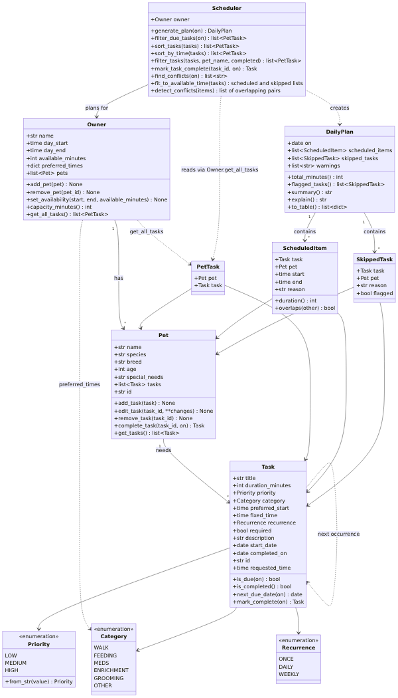

# PawPal+ (Module 2 Project)

You are building **PawPal+**, a Streamlit app that helps a pet owner plan care tasks for their pet.

## Scenario

A busy pet owner needs help staying consistent with pet care. They want an assistant that can:

- Track pet care tasks (walks, feeding, meds, enrichment, grooming, etc.)
- Consider constraints (time available, priority, owner preferences)
- Produce a daily plan and explain why it chose that plan

Your job is to design the system first (UML), then implement the logic in Python, then connect it to the Streamlit UI.

## What you will build

Your final app should:

- Let a user enter basic owner + pet info
- Let a user add/edit tasks (duration + priority at minimum)
- Generate a daily schedule/plan based on constraints and priorities
- Display the plan clearly (and ideally explain the reasoning)
- Include tests for the most important scheduling behaviors

## 🧩 Implementation Summary

**What was built.** The backend is in [pawpal_system.py](pawpal_system.py): a small domain model plus a `Scheduler` that turns it into a one-day plan with a reason for every decision. [main.py](main.py) is a command-line demo, [app.py](app.py) is the Streamlit UI, connected to those classes. The pytest suite (130 tests) is in [tests/test_pawpal.py](tests/test_pawpal.py) for the backend and [tests/test_app.py](tests/test_app.py) for the UI, and [diagrams/uml.mmd](diagrams/uml.mmd) is the class diagram, kept in sync with the backend code. The picture below is a rendering of it (the Mermaid source is `diagrams/uml.mmd`).



**How the classes work together**

- An `Owner` has many `Pet`s, and a `Pet` has many `Task`s. The owner also holds the day window (and an optional daily minutes cap) that a plan must fit inside.
- `Owner.get_all_tasks()` returns every pet's tasks together as `PetTask(pet, task)` pairs. The `Scheduler` reads tasks only through this method, so it always plans across all pets, never one.
- `Scheduler.generate_plan(date)` runs a pipeline: keep the tasks due that day (`Task.is_due`: it has started and is not completed), sort them (required first, then priority, then shorter), fit them onto the clock, and return a `DailyPlan`.
- A `DailyPlan` holds the `ScheduledItem`s (a task at a start and end time, with the reason), the `SkippedTask`s (a task and why it was dropped, `flagged` when a required task could not fit) and a list of warnings. It can print itself as text (`explain()`) or as table rows (`to_table()`).

**Scheduling rules.** There is one owner, so tasks never overlap, even across pets. Fixed-time tasks are placed first; other tasks go at their preferred time if it is free, otherwise in the earliest gap that fits. A task that does not fit is skipped with a reason, and later tasks are still tried. A required task that does not fit is flagged for the owner; it is never forced in by bumping other tasks.

**How the UI connects to the classes** ([app.py](app.py)). `app.py` holds no planning logic; it only collects input, calls the classes above, and displays the result.

- **Memory:** Streamlit re-runs the script on every click, so the `Owner` is kept in `st.session_state`. The app checks `"owner" not in st.session_state` and creates the `Owner` only the first time; after that it reuses the stored object, so pets and tasks persist.
- **Forms call methods:** "Add pet" calls `Owner.add_pet(Pet(...))`; "Add task" calls `Pet.add_task(Task(...))`; "Save changes" calls `Pet.edit_task`; "Save availability" calls `Owner.set_availability`. The classes validate the input, and the UI shows any `ValueError` as an error message.
- **Buttons call methods:** "Done" calls `Scheduler.mark_task_complete` (which creates the next occurrence of a daily or weekly task), and "Remove" calls `Pet.remove_task` or `Owner.remove_pet`, as button callbacks that run before the page redraws.
- **Pets as tiles:** each pet is a bordered tile (icon, name, species, breed and age, open and done task counts, and Select / Remove buttons), laid out three to a row. Selecting a tile chooses which pet new tasks are added to, and a newly added pet is selected automatically. There is no pet dropdown anywhere: the task form follows the selected tile, and the task list has a "Show tasks for" choice between all pets and the selected one.
- **Task list:** it is built with `Scheduler.filter_tasks` (by pet and by Open / Done / All) and ordered with `Scheduler.sort_by_time`. Overlapping fixed-time tasks show a warning from `Scheduler.find_conflicts` as soon as they are added.
- **The daily limit:** "Max care minutes per day" (0 = no limit) caps what the plan schedules each day. Adding tasks is never blocked; instead, the Tasks section warns as soon as today's tasks add up to more than the available time (`Owner.capacity_minutes()`), and the plan then skips the lowest-priority tasks that do not fit, with a reason, and flags any required task it cannot place.
- **Updating the display:** after a successful change the app saves a message and calls `st.rerun()`, so every list shows the new state. "Generate schedule" calls `Scheduler.generate_plan`, and the plan is rebuilt from the live `Owner` on every run, so it never goes stale; it appears as a table with warnings and a "Why this plan?" explanation.

Run `streamlit run app.py` for the app, `python main.py` for the command-line demo, and `pytest` for the tests.

## Getting started

### Setup

```bash
python -m venv .venv
source .venv/bin/activate  # Windows: .venv\Scripts\activate
pip install -r requirements.txt
```

### Suggested workflow

1. Read the scenario carefully and identify requirements and edge cases.
2. Draft a UML diagram (classes, attributes, methods, relationships).
3. Convert UML into Python class stubs (no logic yet).
4. Implement scheduling logic in small increments.
5. Add tests to verify key behaviors.
6. Connect your logic to the Streamlit UI in `app.py`.
7. Refine UML so it matches what you actually built.

## 🖥️ Sample Output

Output of `python main.py`, which builds an owner with two pets and eight tasks added out of time order, then shows sorting, filtering, a conflict warning, today's schedule, and recurring tasks being completed. Dates in the output are the day the script is run, so they change daily.

```
========================================================================
1. Tasks in the order they were added (out of time order):
  Evening fetch (Biscuit) - prefers 18:00, once, due Oct 18
  Lunch feeding (Biscuit) - fixed at 12:00, daily, due Oct 18
  Heart medication (Biscuit) - fixed at 08:00, daily, due Oct 18
  Morning walk (Biscuit) - prefers 07:30, daily, due Oct 18
  Laser-pointer play (Mochi) - prefers 15:30, once, due Oct 18
  Flea treatment (Mochi) - no set time, once, due Oct 18
  Vet check-in call (Mochi) - fixed at 12:00, once, due Oct 18
  Brush fur (Mochi) - prefers 09:00, weekly, due Oct 18

2. Sorted by time - Scheduler.sort_by_time():
  Morning walk (Biscuit) - prefers 07:30, daily, due Oct 18
  Heart medication (Biscuit) - fixed at 08:00, daily, due Oct 18
  Brush fur (Mochi) - prefers 09:00, weekly, due Oct 18
  Lunch feeding (Biscuit) - fixed at 12:00, daily, due Oct 18
  Vet check-in call (Mochi) - fixed at 12:00, once, due Oct 18
  Laser-pointer play (Mochi) - prefers 15:30, once, due Oct 18
  Evening fetch (Biscuit) - prefers 18:00, once, due Oct 18
  Flea treatment (Mochi) - no set time, once, due Oct 18

3. Filtered by pet - Scheduler.filter_tasks(pet_name='mochi'):
  Laser-pointer play (Mochi) - prefers 15:30, once, due Oct 18
  Flea treatment (Mochi) - no set time, once, due Oct 18
  Vet check-in call (Mochi) - fixed at 12:00, once, due Oct 18
  Brush fur (Mochi) - prefers 09:00, weekly, due Oct 18

4. Conflict warnings - Scheduler.find_conflicts():
  Conflict (different pets): 'Lunch feeding' (Biscuit, 12:00-12:10) overlaps 'Vet check-in call' (Mochi, 12:00-12:15)

========================================================================
Today's Schedule - Sunday, October 18, 2026
Owner: Jordan | Pets: Biscuit, Mochi
Available: 07:00-20:00
========================================================================
07:00-07:05  Flea treatment (Mochi), 5 min, low priority
             why: Scheduled (low priority): earliest free slot, 07:00-07:05
07:30-08:00  Morning walk (Biscuit), 30 min, high priority
             why: Scheduled (high priority): at its preferred time, 07:30-08:00
08:00-08:05  Heart medication (Biscuit), 5 min, high priority [REQUIRED]
             note: One pill, hidden in a bit of cheese
             why: Scheduled (required, high priority): at its fixed time, 08:00-08:05
09:00-09:15  Brush fur (Mochi), 15 min, low priority
             why: Scheduled (low priority): at its preferred time, 09:00-09:15
12:00-12:10  Lunch feeding (Biscuit), 10 min, high priority
             why: Scheduled (high priority): at its fixed time, 12:00-12:10
15:30-15:50  Laser-pointer play (Mochi), 20 min, medium priority
             why: Scheduled (medium priority): at its preferred time, 15:30-15:50
18:00-18:25  Evening fetch (Biscuit), 25 min, medium priority
             why: Scheduled (medium priority): at its preferred time, 18:00-18:25
------------------------------------------------------------------------
Not scheduled:
  Vet check-in call (Mochi): Skipped (medium priority): fixed time 12:00-12:15 clashes with 'Lunch feeding' (Biscuit) at 12:00-12:10
------------------------------------------------------------------------
WARNING: 'Vet check-in call' for Mochi could not be placed at its fixed time 12:00. Skipped (medium priority): fixed time 12:00-12:15 clashes with 'Lunch feeding' (Biscuit) at 12:00-12:10
========================================================================
7 scheduled (110 min), 1 skipped

========================================================================
5. Recurring tasks - Scheduler.mark_task_complete():
  Heart medication (Biscuit) is daily: done today, new one due Monday, October 19.
  Brush fur (Mochi) is weekly: done today, new one due Sunday, October 25.
  Flea treatment (Mochi) is once: done, nothing new created.

6. Filtered by status - completed=True:
  Heart medication (Biscuit) - fixed at 08:00, daily, done Oct 18
  Flea treatment (Mochi) - no set time, once, done Oct 18
  Brush fur (Mochi) - prefers 09:00, weekly, done Oct 18

   Filtered by status - completed=False (open):
  Morning walk (Biscuit) - prefers 07:30, daily, due Oct 18
  Heart medication (Biscuit) - fixed at 08:00, daily, due Oct 19
  Brush fur (Mochi) - prefers 09:00, weekly, due Oct 25
  Lunch feeding (Biscuit) - fixed at 12:00, daily, due Oct 18
  Vet check-in call (Mochi) - fixed at 12:00, once, due Oct 18
  Laser-pointer play (Mochi) - prefers 15:30, once, due Oct 18
  Evening fetch (Biscuit) - prefers 18:00, once, due Oct 18
```

Things to notice: section 2 reorders the tasks by time (the task with no time goes last); section 4 warns that two tasks overlap at 12:00 for different pets; the schedule keeps the higher-priority one and skips the other with a reason and a warning; section 5 shows the daily and weekly tasks creating a new occurrence (tomorrow, and next week) while the one-off creates nothing; section 6 filters by completion status. The skip, flag and warning cases are also covered by the pytest suite (see Testing PawPal+).

## 🧪 Testing PawPal+

```bash
# Run the full test suite:
pytest

# Run with coverage:
pytest --cov
```

Sample test output:

```
# Paste your pytest output here
```

## 📐 Smarter Scheduling

Phase 4 added four features on top of the basic planner. Each is implemented by a named method, and `python main.py` demonstrates all of them.

| Feature | Method(s) | What it does |
|---------|-----------|--------------|
| Sorting by time | `Scheduler.sort_by_time()` (uses `Task.requested_time`) | Orders tasks by the time they ask for, earliest first; tasks with no time go last |
| Filtering | `Scheduler.filter_tasks()` | Keeps tasks for one pet and/or with one completion status |
| Conflict detection | `Scheduler.find_conflicts()`; `Scheduler.detect_conflicts()`; clash handling in `Scheduler.fit_to_available_time()` | Warns about overlapping fixed-time tasks, and resolves clashes when planning |
| Recurring tasks | `Task.mark_complete()`, `Task.next_due_date()`, `Pet.complete_task()`, `Scheduler.mark_task_complete()` | Completing a daily or weekly task creates the next occurrence |

(The planner itself orders tasks by importance, not by time, with `Scheduler.sort_tasks()`: required first, then priority, then shorter.)

**Sorting.** `sort_by_time` uses `sorted()` with a lambda key that returns a tuple: the requested time (`fixed_time`, else `preferred_start`), with `time.max` standing in for "no time" so those tasks sort last without comparing a time to `None`; then higher priority; then title. Times are stored as `datetime.time` values, which compare correctly as they are. Zero-padded `"HH:MM"` strings would also sort correctly, but a string such as `"9:30"` would not, so strings were not used. It returns a new list and leaves its input unchanged.

**Filtering.** `filter_tasks(tasks=None, *, pet_name=None, completed=None)` keeps tasks for a pet (matched ignoring case) and/or by completion status (`True` for finished, `False` for open, `None` for any). Filters combine, an unknown pet gives an empty list, and with no list given it starts from every pet's tasks via `Owner.get_all_tasks()`.

**Conflict detection.** `find_conflicts(on)` returns a list of plain warning messages and never raises or changes anything. It checks every pair of due tasks that have a fixed time, for the same pet or different pets, and uses duration, so two tasks conflict when their time ranges overlap, not only when they start in the same minute (back-to-back tasks do not conflict). When a plan is built, `fit_to_available_time()` resolves the same clashes: it keeps the task that sorts first (required, then priority) and skips the other with a reason and a plan warning. `detect_conflicts()` checks a finished plan, where it should always find none. Both checks share one efficient search, `_overlapping_pairs()`: the spans are sorted by start time once, and each span is compared only with the later ones that start before it ends, stopping at the first that does not. The cost is about the sort plus the number of overlaps found, so a conflict-free day is checked in a single pass (measured at roughly 475 times faster than comparing every pair for 1000 tasks).

**Recurring tasks.** `Task.mark_complete(on)` marks the task done and, for a daily or weekly task, returns a new copy (new id, same details) that is due on `Task.next_due_date(on)`; `Pet.complete_task()` adds it to the pet, and `Scheduler.mark_task_complete(task_id, on)` finds the right pet first. The date is calculated with `timedelta`: a daily task is next due the day after (`on + timedelta(days=1)`), a weekly one a week later. Dates stay on the task's own schedule, so a weekly Monday task finished late on Wednesday is next due the following Monday, not a week from Wednesday. A one-off task, or one already completed, creates nothing, so completing twice never makes a duplicate. Each series has one open occurrence at a time, and finished ones stay in the list as history (filter by status to see them).

**Tradeoffs.** Conflict detection only looks at fixed-time tasks, because flexible tasks have no committed slot and the planner moves them to avoid overlaps. Because the next occurrence is created only when a task is completed, the plan cannot preview future occurrences of a recurring task beyond the next one.

## 📸 Demo Walkthrough

Describe your app in numbered steps so a reader can follow along without watching a video:

1. <!-- Describe this step -->
2. <!-- Describe this step -->
3. <!-- Describe this step -->
4. <!-- Describe this step -->
5. <!-- Add more steps as needed -->

**Screenshot or video** *(optional)*: <!-- Insert a screenshot or link to a demo video here -->
